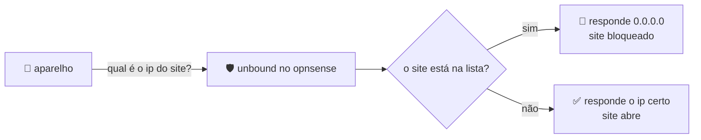

# bloqueio de sites por dns com opnsense

**unbound + dns blocklist + regras de firewall: uma rede mais segura, sem instalar nada nos aparelhos.**

[**▶ ver a apresentação online**](https://slide-sh3p.onrender.com)

---

## 📌 o que é?

o **opnsense** é um firewall *open source*, ou seja, de código aberto. neste projeto usamos duas peças dele:

| peça | para que serve |
|---|---|
| **unbound** | é o servidor dns: a "lista telefônica da internet", que descobre o ip certo de cada site. |
| **dns blocklist** | uma lista de sites proibidos que o unbound consulta antes de responder. |

## ⚙️ como funciona

quando alguém tenta abrir um site, o dns confere a lista. se o site estiver nela, a conexão nem começa. se não estiver, abre normal.

o bloqueio vale para o **site inteiro**, e não só para uma página. por isso usamos também regras de firewall, que formam uma camada extra.

## 🧩 passo a passo

### 1. ativar o unbound e entregar o dns
- ativar o **modo avançado** do unbound e ligá-lo na interface **lan** (a rede local).
- em **dnsmasq → dhcp options**, escolher a interface lan, definir a opção de **dns** e colocar o **ip do opnsense** como valor.

### 2. escolher as listas de bloqueio
em **blocklist → edit**:

| lista | em uma palavra | o que bloqueia |
|---|---|---|
| **abuse.ch - threatfox ioc** | malware | endereços usados para espalhar vírus e golpes |
| **adguard** | anúncios | propagandas e rastreadores |

### 3. forçar o dns (destination nat)
para ninguém fugir da lista usando outro dns, criamos uma regra no firewall:

- **interface:** lan
- **porta:** 53 (a porta do dns)
- **protocolo:** tcp/udp, **ipv4**
- **redirecionar para:** localhost (*loopback*), o próprio opnsense

assim, mesmo que o aparelho pergunte ao dns do google, o firewall entrega a pergunta ao unbound.

## ✅ resultado

- o bloqueio funciona para os aparelhos que usam o dns do opnsense (testado com o **facebook**).
- as consultas de dns foram redirecionadas para o unbound.

## ⚠️ limitações

ainda não conseguimos impedir quem usa **vpn** ou **dns seguro (doh) no navegador** de contornar o bloqueio.

## 🖥️ ver os slides

a apresentação é um único arquivo html (`index.html`). basta abrir no navegador ou acessar o site: https://bloqueio-dns.onrender.com/

## 👥 equipe

- bianca
- raphaella
- marina
